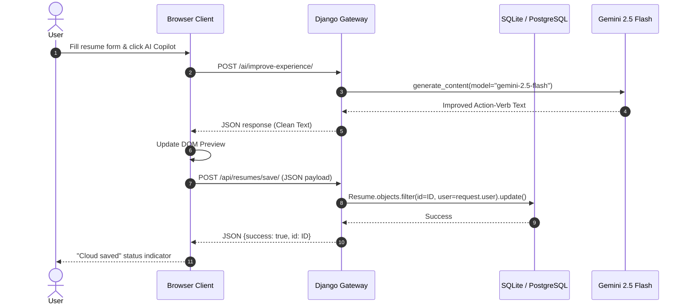

# ResumeCraft AI – Comprehensive Technical Project Guide & Viva Prep

> **A Complete Reference Manual for Students, Instructors, and Examiners**  
> *Project: ResumeCraft AI – Build Your Professional Identity*  
> *Course: B.Tech Computer Science and Engineering*

---

## Table of Contents
1. [Executive Summary & Architectural Paradigm](#1-executive-summary--architectural-paradigm)
2. [Dual-Database Architecture (SQLite & PostgreSQL)](#2-dual-database-architecture-sqlite--postgresql)
3. [User Authentication & Security Subsystem](#3-user-authentication--security-subsystem)
4. [Django Models & JSONField Design](#4-django-models--jsonfield-design)
5. [Django Backend Architecture (Views & APIs)](#5-django-backend-architecture-views--apis)
6. [Google Gemini AI Integration Layer](#6-google-gemini-ai-integration-layer)
7. [Frontend Architecture & State Management](#7-frontend-architecture--state-management)
8. [High-Fidelity PDF Generation Engine](#8-high-fidelity-pdf-generation-engine)
9. [Production Deployment on Render](#9-production-deployment-on-render)
10. [End-to-End Data Flow Diagrams](#10-end-to-end-data-flow-diagrams)
11. [25 Beginner-Friendly Viva Questions & Comprehensive Answers](#11-25-beginner-friendly-viva-questions--comprehensive-answers)

---

## 1. Executive Summary & Architectural Paradigm

**ResumeCraft AI** is a production-ready web application built to solve a critical challenge faced by engineering students and job seekers: crafting modern, ATS-compatible resumes tailored with generative AI, with secure multi-user authentication, cloud persistence, and high-fidelity PDF export.

The system is organized around a **Hybrid Cloud & Edge Architecture**:
- **Authentication Tier**: Django built-in auth system with secure PBKDF2/SHA-256 password hashing and session management.
- **Database Tier**: Dual database support—SQLite locally for zero-config developer setup, and PostgreSQL on Render via `dj-database-url` and `psycopg2-binary`.
- **Hybrid Guest Mode**: Unauthenticated visitors can create resumes in browser `localStorage`, with 1-click cloud sync once they register.
- **Backend Tier (Django Gateway)**: Manages secure proxying of Google Gemini AI requests, protects API credentials, verifies CSRF tokens, and delivers compressed static assets via WhiteNoise.
- **AI Tier (Google GenAI)**: Employs Google's latest `gemini-2.5-flash` model via the official Python SDK to deliver 8 domain-specific career acceleration tools.

```
+-------------------------------------------------------------+
|                     CLIENT BROWSER                          |
|  +--------------------+   +-------------------------------+  |
|  | HTML5 / CSS3 / JS  |   | localStorage (Guest Mode)     |  |
|  | - Two-Way Binding  |<->| - Local Resumes & Cache       |  |
|  | - Live A4 Preview  |   | - 1-Click Cloud Import        |  |
|  +---------+----------+   +-------------------------------+  |
+------------|------------------------------------------------+
             | Secure AJAX / JSON (CSRF & Session Protected)
             v
+-------------------------------------------------------------+
|                     DJANGO BACKEND                          |
|  - urls.py: Clean Route Dispatch & Admin                    |
|  - views.py: Function-Based Request Handlers                |
|  - models.py: User (Auth) + Resume (JSONField)              |
|  - ai_service.py: Google GenAI Python SDK Controller        |
+------------+------------------------------------------------+
             |                              |
             v                              v
+---------------------------+  +------------------------------+
|     DATABASE LAYER        |  |   GOOGLE GEMINI 2.5 FLASH    |
| - SQLite: Local Dev       |  | - Professional Summary       |
| - PostgreSQL: Render Prod |  | - Experience Optimizer       |
| - Strictly User-Isolated  |  | - ATS Compatibility Analysis |
+---------------------------+  +------------------------------+
```

---

## 2. Dual-Database Architecture (SQLite & PostgreSQL)

In `resumecraft/settings.py`, the database engine adapts dynamically based on whether a `DATABASE_URL` environment variable is defined:

```python
# resumecraft/settings.py
DATABASES = {
    'default': {
        'ENGINE': 'django.db.backends.sqlite3',
        'NAME': BASE_DIR / 'db.sqlite3',
    }
}

DATABASE_URL = os.getenv('DATABASE_URL')
if DATABASE_URL:
    DATABASES['default'] = dj_database_url.parse(
        DATABASE_URL,
        conn_max_age=600,
        ssl_require=True
    )
```

### Why this design?
1. **Zero Setup for Beginners & Evaluators**: Running `python manage.py runserver` immediately works out of the box using SQLite (`db.sqlite3`). No external Docker or database servers are required.
2. **Production-Ready Scalability**: When deployed to Render, attaching a free Render PostgreSQL database automatically sets `DATABASE_URL`. The application connects to PostgreSQL without altering a single line of application logic.
3. **Database Migrations**: Managed cleanly via `python manage.py makemigrations` and `python manage.py migrate`.

---

## 3. User Authentication & Security Subsystem

ResumeCraft AI leverages Django's battle-tested built-in authentication system (`django.contrib.auth`):

### 3.1. Sign Up & Password Hashing
- When a user signs up, Django hashes the password using `PBKDF2PasswordHasher` with SHA-256 and unique salt per user. Plain-text passwords are **never** stored in the database.
- Enforces duplicate username check, duplicate email check, and Django's `AUTH_PASSWORD_VALIDATORS` (minimum 8 characters, common password check, numeric check).

### 3.2. Flexible Authentication (Username or Email)
The `login_view` allows users to sign in using either their username OR their registered email address:
```python
if '@' in login_id:
    user_obj = User.objects.filter(email__iexact=login_id).first()
    auth_username = user_obj.username if user_obj else None
else:
    auth_username = login_id

user = authenticate(request, username=auth_username, password=password)
```

### 3.3. Profile Updates & Secure Password Change
- Users can update their first name, last name, and email from the `/profile/` dashboard.
- Password change verifies the user's current password (`user.check_password(old_password)`), runs validation, updates the hash, and invokes `update_session_auth_hash(request, user)` so the user is not unexpectedly logged out.

---

## 4. Django Models & JSONField Design

The application defines a clean, elegant relational model in `builder/models.py`:

```python
class Resume(models.Model):
    user = models.ForeignKey(User, on_delete=models.CASCADE, related_name='resumes')
    resume_title = models.CharField(max_length=255, default='My Resume')
    resume_data = models.JSONField(default=dict, blank=True)
    selected_template = models.CharField(max_length=50, default='classic')
    created_at = models.DateTimeField(auto_now_add=True)
    updated_at = models.DateTimeField(auto_now=True)
```

### Why use `JSONField` for `resume_data`?
1. **Best of Both Worlds**: Relational foreign-key ownership guarantees strict data security and multi-user isolation, while the schemaless JSON payload allows limitless flexibility for dynamic resume sections (education, experience, certifications, custom colors, font sizes).
2. **No Brittle Multi-Table Joins**: A traditional schema with 7 separate tables (`Candidate`, `EducationItem`, `ExperienceItem`, `SkillGroup`, etc.) requires complex multi-table joins and cascade deletes. With `JSONField`, the entire resume document is saved, versioned, duplicated, and fetched in a single atomic database query.
3. **Seamless Client Compatibility**: The frontend JavaScript object maps directly 1:1 with the database JSON document with zero translation friction.

---

## 5. Django Backend Architecture (Views & APIs)

### 5.1. Function-Based Views & Request Handlers
All endpoints in `builder/views.py` utilize clean function-based views (FBVs):
- `landing_page`: Renders modern homepage with feature highlights.
- `dashboard_page`: Displays the user's database resumes when logged in, or local browser resumes in guest mode with an import banner.
- `editor_page`: Loads database resume by ID with ownership verification (`get_object_or_404(Resume, id=resume_id, user=request.user)`).
- `signup_view`, `login_view`, `logout_view`, `profile_view`: Complete auth lifecycle.
- `api_resume_save`: Saves or autosaves resume payload to database.
- `api_resume_delete`: Deletes cloud resume with ownership verification.
- `api_resume_duplicate`: Clones existing resume into an independent copy.
- `api_import_local_resumes`: Bulk-imports browser localStorage resumes into user's database account.

---

## 6. Google Gemini AI Integration Layer

### 6.1. Official Google GenAI SDK (`google-genai`)
ResumeCraft AI integrates the modern Google GenAI Python SDK (`google-genai`), utilizing the `client.models.generate_content` interface:

```python
from google import genai
from google.genai import types

client = genai.Client(api_key=os.getenv('GEMINI_API_KEY'))
config = types.GenerateContentConfig(
    temperature=0.4,
    max_output_tokens=1500,
    system_instruction="Strictly avoid fabricating facts, metrics, or credentials."
)
response = client.models.generate_content(
    model='gemini-2.5-flash',
    contents=prompt,
    config=config
)
```

### 6.2. The 8 Specialized AI Features
1. **Professional Summary**: 3-sentence executive summary highlighting technical strengths.
2. **Experience Improver**: Rewrites bullet points using Google's XYZ action-verb framework.
3. **Project Description**: Details system architecture and technical problem-solving.
4. **Skill Suggestions**: Recommends missing modern skills by category.
5. **ATS Compatibility Scanner**: Compares resume text with target job postings, generating dynamic scores, matched keywords, and gap analysis.
6. **Job Description Matcher**: Pinpoints qualification alignment and tailored project highlights.
7. **Career Objective Generator**: Tailored specifically for Freshers, Students, or Professionals.
8. **Resume Audit**: Full diagnostic scan of grammar, tone, balance, and quick-win improvements.

---

## 7. Frontend Architecture & State Management

- **Two-Way Binding**: Form input keystrokes immediately update `currentResume` and re-render `#resumeSheet` in real time.
- **Debounced Cloud Autosave**: 400ms debounce timer sends updates to `/api/resumes/save/` when logged in.
- **Dynamic Repeaters**: Education, Experience, Projects, Certifications, and Achievements can be dynamically added, edited, or removed.
- **Sanitized HTML Rendering**: Markdown lists and bold accents from AI responses are converted to clean, safe HTML without raw markdown syntax.

---

## 8. High-Fidelity PDF Generation Engine

PDF generation uses native client-side printing (`window.print()`) with specialized `@media print` rules:
- Paper format: Exact international A4 (`210mm × 297mm`) with `margin: 10mm`.
- Clean output: All navigation bars, toolbars, and modal elements are hidden during print via `.no-print`.
- Page-break controls: `page-break-inside: avoid;` prevents awkward splitting of experience and project cards across pages.

---

## 9. Production Deployment on Render

Render runs `build.sh`:
```bash
#!/usr/bin/env bash
set -o errexit
pip install -r requirements.txt
python manage.py migrate --no-input
python manage.py collectstatic --no-input
```
And starts the WSGI application with Gunicorn:
```bash
gunicorn resumecraft.wsgi:application
```

---

## 10. End-to-End Data Flow Diagrams

### Authentication & Cloud Resume Save Flow:


---

## 11. 25 Beginner-Friendly Viva Questions & Comprehensive Answers

### Question 1: What database does ResumeCraft AI use?
**Answer:** ResumeCraft AI uses a dual-database architecture: **SQLite** for local development (which requires zero setup and creates `db.sqlite3` automatically), and **PostgreSQL** in production on Render via `dj-database-url` and `psycopg2-binary`.

---

### Question 2: What is Django ORM and what are its benefits?
**Answer:** ORM stands for Object-Relational Mapping. It allows developers to interact with database tables using Python classes (`Resume.objects.filter()`) instead of writing raw SQL queries. This provides database independence, built-in SQL injection protection, and automatic schema migrations.

---

### Question 3: Why did you use `JSONField` for `resume_data` instead of multiple separate tables?
**Answer:** Resumes are semi-structured documents with varied sections (education, projects, certifications, styling options). Using `JSONField` provides strict user ownership via ForeignKey while allowing flexible, dynamic resume structures without complex multi-table joins or constant schema migrations whenever a new resume field is introduced.

---

### Question 4: How does user authentication work in this project?
**Answer:** It uses Django's built-in `django.contrib.auth` system. Passwords are never stored in plain text; instead, they are hashed using the PBKDF2 algorithm with SHA-256 and salt. Sessions are tracked via secure HTTP cookies.

---

### Question 5: How does the application allow users to log in using either username OR email?
**Answer:** In `login_view`, the input is inspected. If it contains an `@` symbol, the system queries `User.objects.filter(email__iexact=login_id).first()` to retrieve the corresponding username, and then passes that username and password to Django's `authenticate()` method.

---

### Question 6: What happens if a user starts building a resume as a guest without logging in?
**Answer:** In Guest Mode, resumes are saved in the browser's `localStorage`. When the user later creates an account or logs in, the dashboard automatically detects local resumes and displays a 1-click banner offering to import them into their cloud database account.

---

### Question 7: How is user data isolated so User A cannot view or edit User B's resumes?
**Answer:** Every database query in `views.py` strictly filters by the authenticated user using `user=request.user` (e.g. `get_object_or_404(Resume, id=resume_id, user=request.user)`). If User B attempts to access User A's resume ID, the server raises an HTTP 404 Not Found error.

---

### Question 8: Which Google Gemini SDK does this project use?
**Answer:** The project uses the official, modern Google GenAI Python SDK (`google-genai`), using the `client.models.generate_content` interface with the `gemini-2.5-flash` model.

---

### Question 9: How does the ATS Resume Analyzer calculate its score?
**Answer:** The ATS scanner extracts keywords and requirements from the job description and compares them against normalized text from all resume sections. It computes a weighted score based on technical skills (40%), experience relevance (25%), education (15%), project relevance (10%), and resume formatting (10%).

---

### Question 10: How does the PDF download work without external libraries?
**Answer:** It uses native browser print rendering (`window.print()`) combined with CSS `@media print` rules. The stylesheet enforces A4 dimensions (`210mm × 297mm`), hides navigation toolbars with `.no-print`, and prevents awkward page breaks with `page-break-inside: avoid`.

---

### Question 11: What is the purpose of WhiteNoise?
**Answer:** WhiteNoise allows Django to serve its own static files (CSS, JS, images, fonts) directly through Gunicorn in production, eliminating the need for Nginx or an external S3 bucket.

---

### Question 12: How are passwords protected during password change?
**Answer:** In `profile_view`, the view calls `user.check_password(old_password)` to verify the current password, validates the new password against Django's complexity validators, hashes the new password with `user.set_password(new_password)`, and calls `update_session_auth_hash(request, user)` so the active session remains authenticated.

---

### Question 13: What is debounced autosave?
**Answer:** Debouncing delays execution until the user has stopped typing for a brief period (e.g., 400ms). Instead of sending an HTTP request on every single keystroke, it waits until the user pauses, dramatically reducing server load and network traffic.

---

### Question 14: What is CSRF and how is it handled in AJAX requests?
**Answer:** CSRF (Cross-Site Request Forgery) prevents unauthorized commands from being transmitted from a malicious website. In ResumeCraft AI, Django sets a `csrftoken` cookie, and client-side JavaScript reads this token using `getCookie('csrftoken')` and passes it in the `X-CSRFToken` header of all POST requests.

---

### Question 15: What are the four resume templates available?
**Answer:**
1. **Professional Classic**: Traditional corporate layout with formal dividers and serif/sans hierarchy.
2. **Modern Minimal**: Contemporary design with colored left border accents and spacious typography.
3. **Developer Portfolio**: Tech-focused layout with monospace accents, tech stack pills, and GitHub links.
4. **Student Fresher**: Academic-first layout prioritizing degree credentials, coursework, and college projects.

---

### Question 16: Does switching templates cause data loss?
**Answer:** No. Presentation and data are decoupled. The resume content is stored in a structured JSON object; switching templates simply changes the CSS layout class on `#resumeSheet` and re-renders the DOM.

---

### Question 17: How is XSS (Cross-Site Scripting) prevented?
**Answer:** In JavaScript, user inputs are sanitized with `escapeHtml()`, and in Django templates, Django's auto-escaping is active by default, ensuring all text strings are escaped before insertion into the DOM.

---

### Question 18: What is Gunicorn and why is it used on Render?
**Answer:** Gunicorn (Green Unicorn) is a production WSGI HTTP server for Python. It manages multiple worker processes to concurrently handle incoming requests in production.

---

### Question 19: What is `build.sh` on Render?
**Answer:** `build.sh` is the automated deployment script that executes `pip install -r requirements.txt`, runs database migrations with `python manage.py migrate --no-input`, and collects static files with `python manage.py collectstatic --no-input`.

---

### Question 20: What are Django migrations?
**Answer:** Migrations are Django's way of propagating changes made to Python models (such as creating the `Resume` model) into the database schema. They ensure the database tables stay synchronized with the model definitions.

---

### Question 21: How does the application handle Gemini API failures gracefully?
**Answer:** All AI calls in `ai_service.py` are wrapped in `try...except` blocks. If an API key is missing or quota is exhausted, the application falls back to intelligent domain-specific sample suggestions and informs the user rather than throwing a 500 error.

---

### Question 22: How can an administrator manage users and resumes?
**Answer:** By running `python manage.py createsuperuser`, an administrator account is created. The admin can log in at `/admin/` to view, search, filter, and manage all registered users and resume records.

---

### Question 23: How does the application support responsive design on mobile phones?
**Answer:** It uses Bootstrap 5 responsive grid layouts, collapsible mobile navigation, and a dedicated mobile tab switcher (`#tabBtnEditor` vs `#tabBtnPreview`) allowing users to easily toggle between form input and live A4 preview on screens under 992px.

---

### Question 24: How does the resume completion percentage get calculated?
**Answer:** The `completion_score` property in the `Resume` model evaluates filled sections: Full Name (15%), Email (10%), Title (10%), Summary (15%), Education (15%), Experience (15%), Projects (10%), and Skills (10%), producing an indicative progress score between 20% and 100%.

---

### Question 25: What are the key advantages of this project for a college B.Tech CSE presentation?
**Answer:**
1. It combines full-stack web engineering (Django, PostgreSQL, ORM, Auth, Bootstrap) with modern Generative AI (Gemini 2.5 Flash SDK).
2. The code is written with clean, understandable function-based views that are easy to explain during a viva exam.
3. It solves a real-world student problem (building ATS-optimized resumes) with production deployment on Render.
